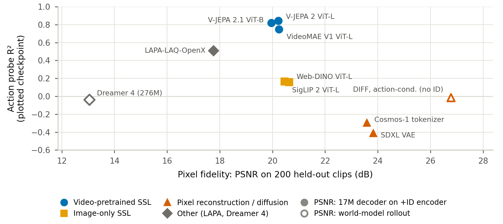
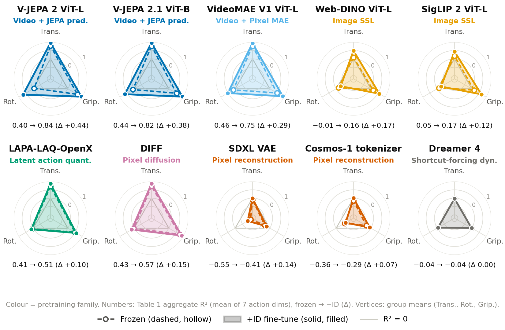
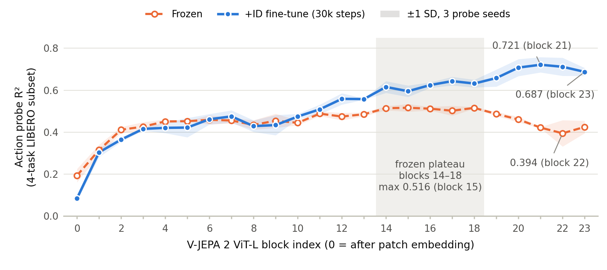

# Main results

Values are copied from the camera-ready paper. Action probe R² is the mean over the 7 action dimensions and 3 probe seeds.

**Evaluation coverage.** Tables 1 and 3 and Figures 1–3 use a fixed subset of the LIBERO held-out tasks: the probe is fit on the first 400 training episodes (10 of the 104 training tasks) and evaluated on the first 200 held-out episodes (4 of the 26 held-out tasks). The matched controls (Table 2) use all 26 held-out tasks. Absolute probe values depend on this coverage (Appendix M of the paper).

## Pixel fidelity does not imply action recoverability (Figure 1)

Each point is one checkpoint: action probe R² against PSNR on the same 200 held-out clips. Encoder-only backbones use a 17M pixel decoder trained on the +ID encoder (filled markers); pixel-producing world models use rollout PSNR (hollow markers). The highest-PSNR models have R² ≤ 0, while the video-pretrained encoders reach the highest R² at moderate PSNR. The comparison is descriptive. Data: `paper_figures/data/results.jsonl`, `paper_figures/data/decoder_results.jsonl`; script: `paper_figures/src/build_fig1_pixel_vs_action.py`.

## Inverse-dynamics lift by backbone (Table 1)

| Backbone | Family | Params | Frozen | + ID | Δ |
|---|---|---:|---:|---:|---:|
| V-JEPA 2 ViT-L | Video + JEPA prediction | 304M | 0.40 | **0.84** | **+0.44** |
| V-JEPA 2.1 ViT-B | Video + JEPA prediction | 87M | 0.44 | 0.82 | +0.38 |
| VideoMAE V1 ViT-L | Video + pixel MAE | 304M | 0.46 | 0.75 | +0.29 |
| Web-DINO ViT-L | Image SSL | 304M | −0.01 | 0.16 | +0.17 |
| SigLIP 2 ViT-L | Image SSL (image–text) | 316M | 0.05 | 0.17 | +0.12 |
| LAPA-LAQ-OpenX | Latent action quantization | 344M | 0.41 | 0.51 | +0.10 |
| DIFF | Pixel diffusion (trained on LIBERO) | 91M | 0.43 | 0.57 | +0.15 |
| SDXL VAE | Pixel reconstruction | 34M | −0.55 | −0.41 | +0.14 |
| Cosmos-1 tokenizer | Pixel reconstruction | 34M | −0.36 | −0.29 | +0.07 |
| Dreamer 4 (reproduction) | Shortcut dynamics (trained on LIBERO) | 64–276M | −0.04 | −0.04 | 0.00 |

All backbones share the ID objective and probe; optimization settings differ by backbone (Appendix G). Per-run records: `paper_figures/data/results.jsonl`.

## Is the lift driven by transition–action correspondence? (Table 2, matched controls)

Each backbone is fine-tuned from the same public checkpoint for 20k updates under true ID, within-task action-shuffled ID, or forward dynamics (FD); the training heads are discarded before fresh probes are fitted.

| Encoder | Frozen | True ID | Action-shuffled ID | FD | Δ₂₆ (true − shuffled) [95% CI] |
|---|---:|---:|---:|---:|---|
| V-JEPA 2 ViT-L | 0.455 | **0.863** | 0.184 | 0.326 | 0.836 [0.752, 0.952] |
| VideoMAE V1 ViT-L | 0.513 | 0.829 | 0.422 | 0.454 | 0.578 [0.518, 0.658] |
| Web-DINO ViT-L | 0.075 | 0.156 | 0.063 | −0.071 | 0.097 [0.026, 0.156] |

Absolute columns: fixed 200-episode subset, two training seeds × three probe seeds. Δ₂₆ pools all 26 held-out tasks with a paired held-out-task cluster bootstrap (10k replicates); it is not the difference of the absolute columns. Per-cell values: [`results/matched_controls_per_cell.csv`](results/matched_controls_per_cell.csv).

## Per-dimension recovery and the V-JEPA 2 trunk (Figures 2 and 3)

Per-dimension R² (translation, rotation, gripper) for each backbone, frozen and +ID. Rotation separates the families most strongly.

Probe R² for each of the 24 V-JEPA 2 ViT-L blocks: frozen features plateau in the middle of the trunk and fall through the late blocks; after ID fine-tuning the maximum moves to block 21. Block outputs are read before the final LayerNorm. Data: `paper_figures/data/vjepa_per_layer*.jsonl`.

## Robustness to visual perturbation (Table 3)

The probe is trained on clean features and evaluated on perturbed inputs. "Worst" is the minimum over Gaussian noise (std 0.05, 0.10, 0.15), color jitter (0.10, 0.20), and Gaussian blur (kernel 5, 11).

| Backbone | Frozen clean | Frozen noise 0.15 | Frozen worst | +ID clean | +ID noise 0.15 | +ID worst |
|---|---:|---:|---:|---:|---:|---:|
| V-JEPA 2 ViT-L | 0.40 | −1.18 | −4.66 | **0.84** | **0.66** | **0.56** |
| V-JEPA 2.1 ViT-B | 0.44 | −5.36 | −5.36 | 0.82 | 0.01 | 0.01 |
| VideoMAE V1 ViT-L | 0.46 | −2.54 | −2.54 | 0.75 | 0.11 | 0.11 |
| Web-DINO ViT-L | −0.01 | −4.19 | −4.19 | 0.16 | 0.08 | −0.05 |
| SigLIP 2 ViT-L | 0.05 | −0.62 | −1.75 | 0.17 | −0.09 | −0.40 |
| LAPA-LAQ-OpenX | 0.41 | −1.14 | −1.14 | 0.51 | −0.19 | −0.19 |
| DIFF | 0.43 | 0.44 | 0.24 | 0.57 | 0.57 | 0.46 |
| SDXL VAE | −0.55 | −1.96 | −1.96 | −0.41 | −2.20 | −2.20 |
| Cosmos-1 tokenizer | −0.36 | −0.80 | −0.94 | −0.29 | −0.86 | −1.09 |
| Dreamer 4 | −0.04 | −0.04 | −0.04 | −0.04 | −0.04 | −0.04 |

## Closed-loop target swap (Table 4)

π0.5 is fine-tuned on all five LIBERO suites (10k steps, batch 32) with its flow-matching loss plus an auxiliary loss toward a frozen target. Success rate (%): LIBERO is 10 tasks × 10 trials per suite; the LIBERO-PRO columns are the five shifts on LIBERO-10; "All" averages the five shifts over all four suites.

| Auxiliary target | Spat. | Obj. | Goal | L10 | Avg. | Lang. | Pos. | Obj. | Task | Env. | PRO All |
|---|---:|---:|---:|---:|---:|---:|---:|---:|---:|---:|---:|
| None (π0.5 baseline) | 96 | 99 | 97 | 80 | 93.0 | 65 | 8 | 79 | 15 | 47 | 68.7 |
| *Clip coupling (normalized L2, weight 0.1)* | | | | | | | | | | | |
| DIFF + ID † | 96 | 98 | 93 | 88 | **93.8** | 63 | **24** | 85 | 16 | 55 | **69.0** |
| — batch-shuffled target | 96 | 99 | 83 | 78 | 89.0 | 65 | 15 | 81 | 15 | 60 | 65.8 |
| — random-init encoder | 95 | 98 | 94 | 87 | 93.5 | 72 | 14 | 82 | 25 | 48 | 67.6 |
| *Token coupling (cosine)* | | | | | | | | | | | |
| V-JEPA 2 + ID (weight 0.01) | 95 | 98 | 90 | 78 | 90.2 | 54 | 23 | 79 | 19 | 55 | 67.5 |
| Web-DINO (weight 0.01) | 99 | 98 | 91 | 86 | 93.5 | 56 | 14 | 83 | 16 | 54 | 65.0 |

All rows are policy seed 0. † A second DIFF + ID policy seed, evaluated only on LIBERO-PRO, reaches Pos. 18 and PRO All 65.1. Bold marks the best observed value in the three headline columns (LIBERO Avg., L10 Pos., PRO All); these are single-run comparisons without uncertainty estimates.

Two further runs are reported in Appendix N of the paper:

| Run | Spat. | Obj. | Goal | L10 | Avg. | Lang. | Pos. | Obj. | Task | Env. | PRO All |
|---|---:|---:|---:|---:|---:|---:|---:|---:|---:|---:|---:|
| DIFF + ID, policy seed 1 | – | – | – | – | – | 57 | 18 | 69 | 12 | 52 | 65.1 |
| V-JEPA 2 + ID, weight 0.05 | 97 | 99 | 82 | 86 | 91.0 | 71 | 8 | 80 | 18 | 47 | 65.8 |

Two learned targets improve the LIBERO-10 position shift over the baseline, but no target shows a clear gain in aggregate out-of-distribution success, and the effects are sensitive to the policy seed and the auxiliary weight. The two couplings also differ in loss and weight, so the groups are not a controlled comparison of target encoders.

Success counts: [`results/closed_loop_success_by_suite.csv`](results/closed_loop_success_by_suite.csv) and [`results/closed_loop_success_by_task.csv`](results/closed_loop_success_by_task.csv). `python closed_loop/summarize.py --csv results/closed_loop_success_by_suite.csv` prints this table.
