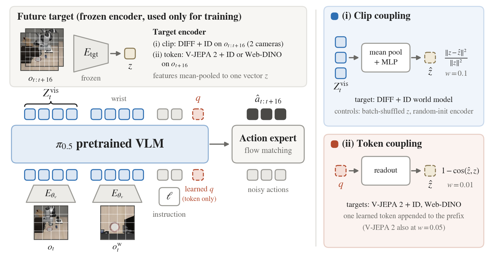
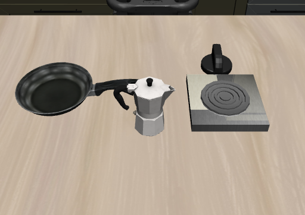
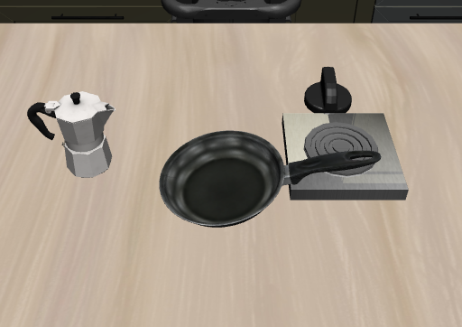

# Closed-loop target swap (Section 4.6, Appendix N)

π0.5 is fine-tuned on LIBERO with its flow-matching action loss plus an auxiliary loss toward a frozen target encoder. The target encoder is used only to compute training targets; it is not needed at inference.



| Coupling | Policy side | Target | Loss, weight |
|---|---|---|---|
| Clip | main-camera prefix tokens, mean-pooled → MLP (hidden 2048) | DIFF + ID world model ([`configs/diff_id.yaml`](../configs/diff_id.yaml)) on the two-camera clip o_t … o_{t+16}: last-frame tokens, mean-pooled | ‖z − ẑ‖² / mean ‖z‖², 0.1 |
| Clip, batch-shuffled | same | targets permuted across the mini-batch | same |
| Clip, random-init | same | same architecture, randomly initialized and frozen | same |
| Token | one learned token appended to the prefix; its output → LayerNorm + linear | V-JEPA 2 ViT-L + ID or Web-DINO ViT-L: mean-pooled feature of o_{t+16} | 1 − cos, 0.01 (V-JEPA 2 also 0.05) |

Shared settings: π0.5 base weights, all five LIBERO suites (90% of demonstrations, demo-level split seeded by `--seed`), 10k steps, batch 32, AdamW (β = 0.9, 0.95; weight decay 0.01), peak learning rate 1.2 × 10⁻⁴ with 200 warmup steps and a cosine decay, gradient clipping 1.0, action horizon 16, bf16 autocast with gradient checkpointing. One 48 GB GPU per run; the clip and Web-DINO runs took about 11 h and the V-JEPA 2 run about 24 h.

## Setup

1. **openpi** (π0.5 in PyTorch). Clone [openpi](https://github.com/Physical-Intelligence/openpi) (our runs used commit `c23745b`) and follow its PyTorch instructions, which copy `src/openpi/models_pytorch/transformers_replace/` into the installed `transformers`. Add `<openpi>/src` to `PYTHONPATH` (or set `OPENPI_SRC`, which the launchers append). Our environment: Python 3.13, torch 2.11, transformers 4.53.2.
2. **π0.5 base weights.** `bash closed_loop/scripts/setup_pretrained.sh pi05_base` downloads the JAX checkpoint from the public `openpi-assets` bucket and converts it to `~/.cache/openpi/pi05_base_pytorch/model.safetensors`.
3. **LIBERO.** Our evaluation used the `libero` package from the [LIBERO-PRO](https://github.com/Zxy-MLlab/LIBERO-PRO) repository (commit `eafdb80`, a LIBERO fork that adds the assets used by the perturbations) in place of stock LIBERO: clone it and `pip install -e .` (or add it to `PYTHONPATH`). Training only needs the HDF5 demonstrations in `datasets/libero/` (see the top-level README). Evaluation renders offscreen with MuJoCo (robosuite 1.4); on a headless GPU node set `MUJOCO_GL=egl`.
4. **Targets.** Downloaded from Hugging Face on first use: V-JEPA 2 + ID (`Dreamer-VLA/dreamer-vla-best-libero-vjepa2-aux`, with the architecture config `facebook/vjepa2-vitl-fpc64-256`) and Web-DINO (`facebook/webssl-dino300m-full2b-224`). The DIFF + ID target is `Dreamer-VLA/dreamer-vla-libero-aux-lam0p05`; `--target-repo` also accepts a local `ckpt_last.pt` trained with `scripts/train.py --config configs/diff_id.yaml`.

## Training and evaluation

```bash
export PRETRAINED_PI0=~/.cache/openpi/pi05_base_pytorch DATA_ROOT=datasets/libero OPENPI_SRC=/path/to/openpi/src
bash closed_loop/scripts/train.sh clip 0          # rows: baseline clip clip_shuffle clip_randinit vjepa2 vjepa2_w0.05 webdino
bash closed_loop/scripts/eval.sh runs/closed_loop/clip_s0/ckpt_final.pt runs/closed_loop_eval/clip_s0
python closed_loop/summarize.py runs/closed_loop_eval/clip_s0
```

`eval.sh` runs LIBERO (perturbation `none`) and the five LIBERO-PRO perturbations on the four suites, 10 tasks × 10 trials each, replanning every 5 steps with 10 denoising steps. LIBERO-PRO perturbations are applied to the BDDL task files by `perturbation.py` with the configurations in `libero_ood/`, adapted from [LIBERO-PRO](https://github.com/Zxy-MLlab/LIBERO-PRO). The environment perturbation splits each task's trials over all candidate environments. Per-episode seeds are fixed (`seed × 10000 + task × 100 + episode` with a scene seed of 0), so `--seed` does not change the rollouts.

| Original layout | LIBERO-PRO position shift |
|---|---|
|  |  |

LIBERO-10 task 2 ("turn on the stove and put the moka pot on it"), first policy step of episode 0. The position shift swaps the start regions of the moka pot and the frying pan, and the scene is re-sampled with the fixed seed instead of using LIBERO's stored initial states. Rendered with `closed_loop/scripts/render_position_shift.py`.

## Differences from the code that produced Table 4

This is a reduced version of the training script used for the paper, limited to the configurations in Table 4.

- **Same computation.** The data sampling, model construction, losses, optimizer, learning-rate schedule and the order of random-number draws follow the original code, so the same `--seed` gives the same initialization, data order and step-0 losses (see "Check" below). The baseline is the exception: it was trained a month earlier with a version that also built unused modules, so its random stream differs. The original clip-coupling runs built an extra, unused DIFF + ID encoder before the policy; `train.py` builds and discards it to keep the random state aligned. Clip start frames are drawn inside the DataLoader workers, so `train.sh` also sets each row's original worker count (3 for the clip and batch-shuffled runs, 6 for the others, 4 for the baseline).
- **Baseline learning-rate floor.** The baseline run used a cosine floor of 1.2 × 10⁻⁵, while all auxiliary runs used 3 × 10⁻⁶. `train.sh baseline` sets `--end-lr 1.2e-5` to reproduce the reported baseline.
- **Evaluation.** The original evaluation also loaded the token-coupling target encoder and passed its features to the policy, but the learned-token policy does not read them, so the sampled actions are the same. `eval_libero_pro.py` leaves it out. It also accepts checkpoints written by the original code.
- **Batch-shuffled control.** Targets are permuted with `torch.randperm`, so a few samples per batch keep their own target (about one in expectation).

Recorded success counts for every row are in [`results/`](../results); `python closed_loop/summarize.py --csv results/closed_loop_success_by_suite.csv` prints Table 4.

## Check

Step-0 losses with `--seed 0` (forward pass of the first batch, batch 32), computed with the original training code and with `train.py` on the same RTX 3090, and the values logged by the paper's runs on an RTX 6000 Ada:

| Run | Original code (3090) | `train.py` (3090) | Paper run log (RTX 6000 Ada) |
|---|---|---|---|
| Clip, DIFF + ID | loss 0.180189, π0 0.064342, aux 1.158475 | identical | loss 0.1803, π0 0.0645, aux 1.1587 |
| Token, V-JEPA 2 + ID (w 0.01) | loss 0.081108, π0 0.070921, aux 1.018787 | identical | loss 0.0811, π0 0.0709, aux 1.0188 |
| Token, Web-DINO (w 0.01) | loss 0.077263, π0 0.067301, aux 0.996220 | identical | loss 0.0773, π0 0.0673, aux 0.9965 |

Evaluation: on the paper's clip-coupling (DIFF + ID) and V-JEPA 2 token-coupling checkpoints, `eval_libero_pro.py` and the evaluation code used for the paper produced identical action chunks at every replanning step (LIBERO-10 task 0, perturbations `none` and `position`, 2 episodes each; 332 and 328 policy calls).
